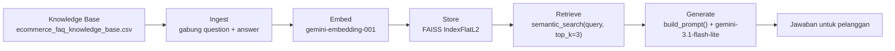

# Semantic Search & LLM Application — Rizky Tria Meditanala

Prototype asisten AI customer service untuk e-commerce: mencari entri FAQ paling relevan terhadap pertanyaan pelanggan secara semantic (meski kata-katanya berbeda dari FAQ), lalu menyusun jawaban natural menggunakan LLM berdasarkan FAQ yang ditemukan.

## Problem Statement

### Objective

Tim customer service e-commerce menerima ratusan pertanyaan repetitif setiap hari seputar pemesanan, pengiriman, pembayaran, hingga pengembalian barang. Project ini membangun prototype sistem yang dapat menjawab pertanyaan pelanggan secara otomatis berdasarkan knowledge base FAQ yang sudah ada — mengubah FAQ menjadi embedding, menyimpannya di vector database, melakukan semantic search terhadap pertanyaan pelanggan, lalu menghasilkan jawaban menggunakan LLM berdasarkan hasil retrieval. Prototype ini menjadi persiapan langsung sebelum dikembangkan menjadi RAG system penuh pada sesi berikutnya.

### Sumber dan Struktur Knowledge Base

Knowledge base FAQ disediakan oleh program AI Engineering Bootcamp ([Google Drive](https://drive.google.com/file/d/1A1m685JChJQ3gvUDh-IBWdj-F2O7_mL_/view?usp=sharing)), tersimpan utuh di `data/ecommerce_faq_knowledge_base.csv`:

| Aspek | Nilai |
| :---- | :---- |
| Jumlah entri | 59 |
| Kolom | `faq_id`, `category`, `question`, `answer` |
| Kategori | 8 — Pemesanan (9), Pengiriman (9), Pembayaran (8), Pengembalian (8), Akun (7), Produk (7), Promo (6), Customer Service (5) |
| Missing values | 0 |
| Pertanyaan duplikat | 0 |

### Batasan dan Asumsi

- Sistem hanya menjawab berdasarkan FAQ yang tersedia di knowledge base — bukan pengetahuan umum LLM.
- Jika informasi tidak ada di knowledge base, sistem harus terus terang menyatakan informasi tidak tersedia, bukan mengarang jawaban.
- Knowledge base tidak diubah sama sekali; setiap entri `question` + `answer` digabung menjadi satu unit teks utuh yang di-retrieve.
- Chunking dokumen panjang tidak diperlukan — setiap entri FAQ sudah merupakan unit pendek yang mandiri.
- Bahasa pengguna dan bahasa knowledge base sama-sama Indonesia; tidak ada penanganan multi-bahasa.

## Struktur Folder

```
assignment-semantic-search/
├── data/
│   ├── ecommerce_faq_knowledge_base.csv
│   └── ecommerce_faq.index
├── notebook/
│   └── starter_notebook_semantic_search.ipynb
├── documentation/
│   └── retrieval_test_results.md
├── README.md
└── requirements.txt
```

## Alur Sistem

| Tahap | Proses | Di notebook |
| :---- | :----- | :---------- |
| **Ingest** | Muat knowledge base FAQ, gabung `question` + `answer` jadi satu unit retrievable per entri | Section 1–2 |
| **Embed** | Ubah tiap unit menjadi vektor dengan Gemini Embeddings API (`gemini-embedding-001`, dimensi 3072) | Section 3 |
| **Store** | Simpan seluruh embedding ke FAISS (`IndexFlatL2`), verifikasi jumlah vektor, tulis index ke file | Section 4 |
| **Retrieve** | Semantic search: query di-embed lalu dicari 3 entri FAQ terdekat di index, lengkap dengan distance | Section 5 |
| **Generate** | Sisipkan hasil retrieval sebagai Context dalam prompt terstruktur (Persona, Task, Context, Format), lalu minta jawaban ke `gemini-3.1-flash-lite` | Section 6–7 |



Knowledge base asli hanya dibaca, tidak pernah diubah. Index FAISS dibangun dari nol setiap notebook dijalankan dan disimpan ke `data/ecommerce_faq.index` (59 vektor × dimensi 3072).

## Hasil Pengujian dan Analisis Relevansi

Sistem diuji dengan 5 query sesuai ketentuan brief: 2 query yang jawabannya ada di FAQ, 2 query berbahasa sendiri (parafrase), dan 1 query yang sengaja tidak ada jawabannya di FAQ. Angka distance adalah tingkat kemiripan dari FAISS — makin kecil makin mirip.

| Query | Tipe | FAQ teratas yang ditemukan | Distance |
| :---- | :--- | :------------------------ | -------: |
| Apa saja metode pembayaran yang tersedia? | Langsung | Metode pembayaran apa saja yang tersedia? | 0.31 |
| Berapa lama estimasi waktu pengiriman? | Langsung | Berapa lama estimasi waktu pengiriman barang? | 0.21 |
| gimana cara tahu pesananku sudah dikirim ke mana? | Parafrase | Bagaimana cara melacak paket yang sedang dikirim? | 0.38 |
| kalau barang yang datang cacat atau beda gambar gimana? | Parafrase | Saya menerima barang yang salah, apa yang harus saya lakukan? | 0.34 |
| Apakah bisa tukar tambah HP lama saya dengan produk baru? | Di luar FAQ | Apakah bisa menukar barang dengan ukuran/warna lain daripada refund? | 0.59 |

- **Query langsung:** kedua query langsung kena FAQ yang tepat di urutan pertama (distance 0.21–0.31, yang paling kecil dari semua percobaan), dan jawabannya persis isi FAQ.
- **Query parafrase:** pertanyaan "gimana cara tahu pesananku sudah dikirim ke mana?" tidak memuat kata lacak atau resi sama sekali, tapi FAQ yang ketemu tetap soal melacak paket. Ini bukti sistem mencari maknanya, bukan kata yang kebetulan sama.
- **Query dua hal sekaligus:** "barang cacat atau beda gambar" ketiga FAQ-nya kebetulan pas semua (barang salah, prosedur pengembalian, paket rusak), tapi jawaban LLM-nya menggabungkan dua kasus itu jadi satu dan cuma menyebut aturan maksimal 3 hari. Padahal untuk barang rusak di FAQ ada aturan sendiri (maksimal 2x24 jam). Lumayan membantu, tapi tidak lengkap.
- **Query di luar FAQ:** sistem tetap menampilkan 3 FAQ terdekat (soal tukar ukuran/warna, ubah nomor telepon, bandingkan produk — tidak ada yang nyambung), tapi LLM-nya jujur bilang belum punya informasi dan menyuruh hubungi customer service, tidak mengarang. Aturan "hanya boleh jawab dari FAQ" di prompt terbukti bekerja.

## Keterbatasan Sistem

- **Belum ada ambang skor (threshold).** Sistem selalu mengambil 3 FAQ terdekat walaupun tidak ada yang cocok. Penolakan pada query di luar FAQ masih tergantung LLM-nya patuh pada prompt, belum dijamin dari sistemnya. Dari pengujian, query yang benar-benar tidak ada jawabannya punya distance di atas 0.5, jadi di masa depan bisa dipasang ambang batas untuk langsung menjawab "tidak tahu" tanpa ke LLM.
- **Pertanyaan yang isinya beberapa hal hasilnya tidak menentu.** Kebetulan semua FAQ yang terambil pas, tapi kalau cuma mengambil satu FAQ teratas pasti jawabannya lebih meleset.
- **Kadang FAQ yang tidak nyambung ikut terambil** (misalnya soal cara memesan pada query metode pembayaran). Tidak mengganggu hasil, tapi pencariannya memang tidak selalu bersih.
- **Hasil LLM bisa berbeda antar-run dan antar-model.** Pengujian terakhir memakai `gemini-3.1-flash-lite` dengan `temperature=0.3`.
- **Setiap run memanggil API** untuk 59 embedding + generate per query, jadi butuh koneksi internet dan mengonsumsi kuota Google AI Studio.

## Cara Menjalankan

```bash
# 1. Buat dan aktifkan virtual environment
python3 -m venv .venv
source .venv/bin/activate

# 2. Instal dependency
pip install -r requirements.txt

# 3. Siapkan API key — buat file .env di root project (tidak di-commit):
#    GEMINI_API_KEY=isi_key_kamu

# 4. Jalankan notebook
jupyter notebook notebook/starter_notebook_semantic_search.ipynb
```

Di notebook, jalankan **Restart & Run All** — seluruh alur (load knowledge base, embedding, pembuatan FAISS index, semantic search, prompt, LLM, pengujian) berjalan berurutan tanpa error.

## Lokasi Output

- Seluruh alur dan hasil pengujian: `notebook/starter_notebook_semantic_search.ipynb`
- FAISS index: `data/ecommerce_faq.index` (59 vektor, dimensi 3072, dibuat otomatis oleh notebook)
